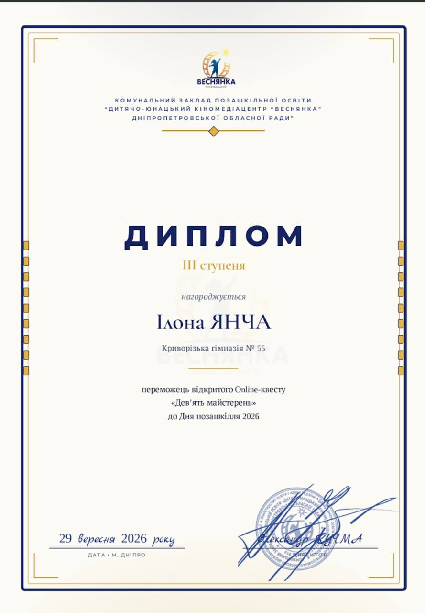
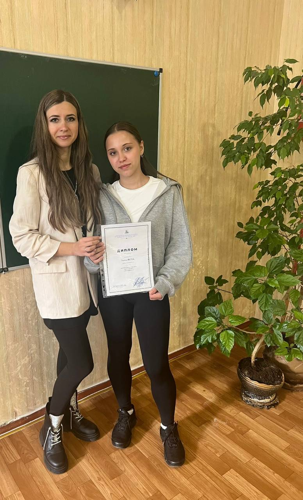

Учениця 9-А класу Янча Ілона взяла участь у відкритому онлайн-квесті «Дев’ять майстерень», організованому до Дня позашкілля 2026 Дитячо-юнацьким кіномедіацентром «Веснянка».

За результатами конкурсу Ілона здобула почесне ІІІ місце! 🥉 🎉

Щиро вітаємо Ілону з чудовим результатом! Бажаємо невичерпного натхнення, творчих успіхів, нових досягнень і впевненого руху до мрій! 💛💙

Висловлюємо подяку за підготовку та підтримку учениці вчителю мистецтва Дубачинській Наталії Олександрівні.

Пишаємося нашими талановитими учнями та бажаємо нових перемог! 🌟

<Gallery>

</Gallery>
