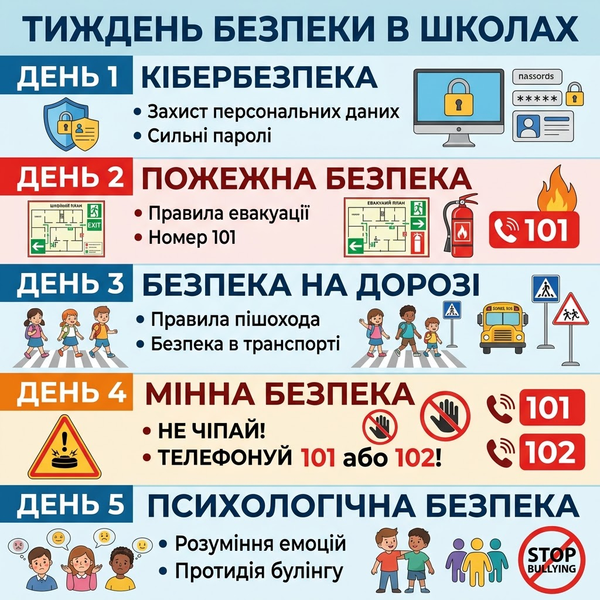

💻 День 1. Кібербезпека — «Секретний код» 🔐\
Учні дізнаються, як захистити персональні дані, створювати надійні паролі, розпізнавати інтернет-шахрайство та уникати небезпек у цифровому просторі.

🔥 День 2. Пожежна безпека — «Увага, евакуація!» 🚒\
Повторюємо правила пожежної безпеки, алгоритми дій у разі виникнення пожежі, порядок безпечної евакуації та правила поводження із засобами пожежогасіння. Закріплюємо знання про виклик рятувальників за номером 101.

🚦 День 3. Безпека дорожнього руху — «Зелений світ» 🚸\
Пригадуємо правила дорожнього руху для пішоходів, безпечної поведінки в громадському транспорті та важливість використання світловідбивних елементів у темну пору доби.

⚠️ День 4. Мінна та техногенна безпека — «Зупинись, не чіпай!» 🚨\
Вчимося розпізнавати потенційно небезпечні предмети та правильно діяти в разі їх виявлення. Закріплюємо життєво важливий алгоритм: не підходь, не чіпай, відійди та повідом дорослих і відповідні служби за номерами 101 або 102!

🤝 День 5. Психологічна безпека та протидія булінгу — «Коло довіри» ❤️\
Говоримо про повагу, толерантність, взаємодопомогу, емоційну підтримку та важливість створення дружнього освітнього середовища. Вчимося розпізнавати прояви булінгу, не залишатися байдужими та своєчасно звертатися по допомогу.

✨ Тиждень безпеки — це не лише повторення правил, а й формування практичних навичок, які можуть урятувати життя!\
Адже наше головне завдання — навчити дітей не розгублюватися перед небезпекою, ухвалювати відповідальні рішення, дбати про себе та допомагати іншим.

💙💛 Безпека починається зі знань, відповідальності та щоденних правильних дій!

Бережімо себе, своїх близьких та одне одного! 🇺🇦

