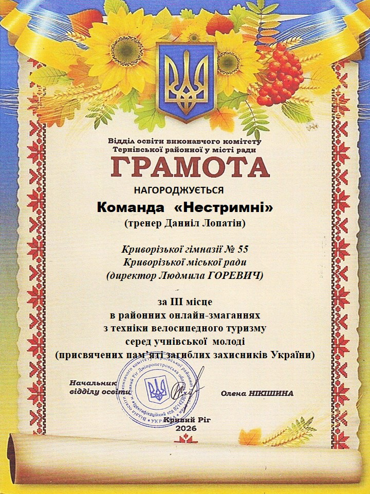

З гордістю ділимося чудовою новиною! Команда «Нестримні» (тренер — Даниїл Лопатін) Криворізької гімназії № 55 здобула III місце у районних онлайн-змаганнях з техніки велосипедного туризму серед учнівської молоді!

Ці змагання були присвячені вшануванню пам'яті загиблих захисників України.
Щиро вітаємо юних спортсменів гімназії та їхнього наставника з гідним результатом! 🚴‍♂️💨 Бажаємо не зупинятися на досягнутому, упевнено підкорювати нові вершини та рухатися тільки вперед до майбутніх перемог! 🎉👏

