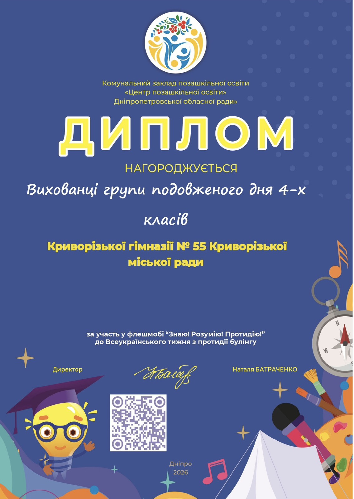

🌟 Щиро вітаємо вихованців групи подовженого дня 4-х класів із нагородженням дипломом за участь у флешмобі «Знаю! Розумію! Протидію!», присвяченому Всеукраїнському тижню з протидії булінгу.

🤝 Участь у таких ініціативах допомагає дітям усвідомити важливість дружби, взаємоповаги, толерантності та підтримки одне одного, а також формує нетерпиме ставлення до будь-яких проявів булінгу.

💙 Адже школа — це простір, де кожна дитина має почуватися захищеною, почутою та важливою!

👏 Вітаємо наших вихованців із відзнакою! Бажаємо нових творчих ідей, цікавих ініціатив та яскравих досягнень!

🌈 Разом створюємо освітнє середовище без булінгу, де панують добро, повага та підтримка!

