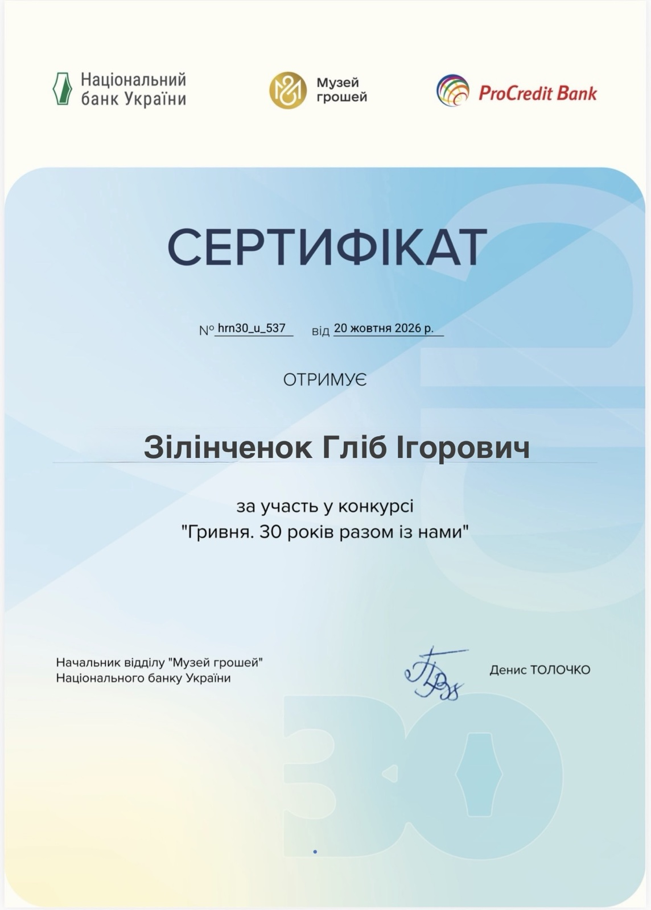
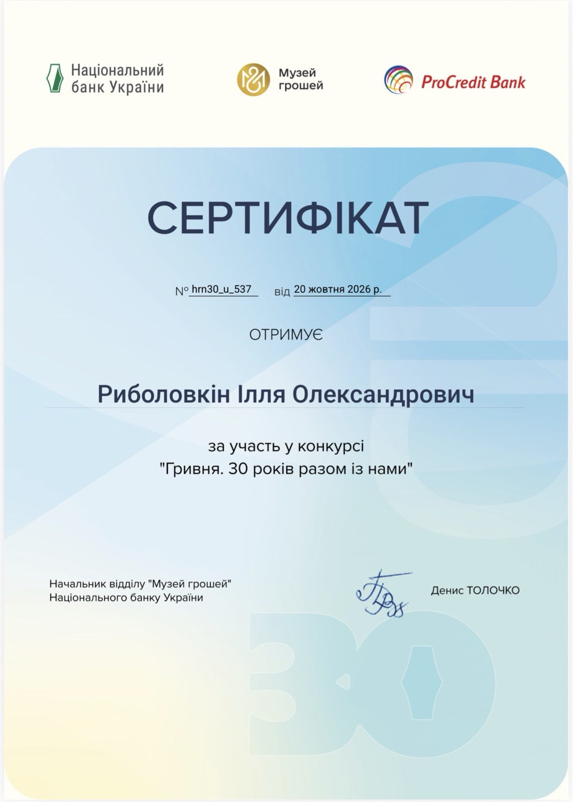

💰 30 років гривні — 30 років фінансової незалежності України!

Здобувачі освіти Криворізької гімназії №55 долучилися до пізнавальних онлайн-заходів Музею грошей Національного банку України, присвячених Дню гривні.

📚 Під час тематичних вебінарів, віртуальних екскурсій та інтерактивних майстер-класів гімназисти відкривали для себе цікаві сторінки історії українських грошей, знайомилися з традиціями грошового обігу та дізнавалися про роль гривні як важливого символу незалежності й державності України.

🏆 Приємним підсумком стала участь у конкурсі «Гривня. 30 років разом із нами»!

За активність і продемонстровані знання іменні сертифікати отримали наші учні:\
✨ Зілінченок Гліб Ігорович;\
✨ Риболовкін Ілля Олександрович.

👏 Щиро вітаємо учасників! Пишаємось їхньою допитливістю, наполегливістю та прагненням до нових знань!

💙💛 Такі освітні ініціативи допомагають школярам розвивати фінансову грамотність, краще розуміти економічні процеси та усвідомлювати цінність національної валюти.

🇺🇦 Пізнаємо історію гривні, навчаємося фінансової грамотності та виховуємо покоління свідомих українців!

<Gallery>

</Gallery>
