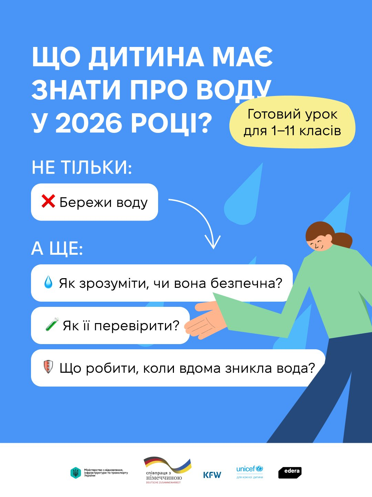

---
title: Як пояснити дітям, що робити, коли вдома немає води, та навчити їх берегти її щодня?
---

ЮНІСЕФ та студія онлайн-освіти EdEra підготували уроки «Місія Вода» — безоплатні навчальні матеріали для учнів 1–11 класів. Вони допоможуть учителям і батькам поговорити з дітьми про перебої з водопостачанням, безпечне використання води та щоденні звички, які допомагають її заощаджувати.

У матеріалах є:

💧 зрозумілі пояснення, як безпечно й ощадливо користуватися водою вдома та в школі;\
🧪 ігри, вікторини й практичні завдання, що допомагають закріпити знання;\
🏠 домашні «водні місії», які діти можуть виконувати разом із батьками.

Матеріали доступні безоплатно за посиланням: [https://ed-era.com/unicef-mission-water/](https://ed-era.com/unicef-mission-water/)

Більше інформації про безпеку води та її раціональне використання – дізнавайтеся на сайті ЮНІСЕФ.

Кампанія реалізується за сприяння @UNICEF Ukraine спільно з @Міністерство економіки, довкілля та сільського господарства України, @Міністерство з відновлення, інфраструктури та транспорту України, а також за фінансової підтримки @Посольство Німеччини в Києві / Deutsche Botschaft Kyjiw та @Bundesministerium für wirtschaftliche Zusammenarbeit und Entwicklung (BMZ) через державний банк розвитку KfW.

